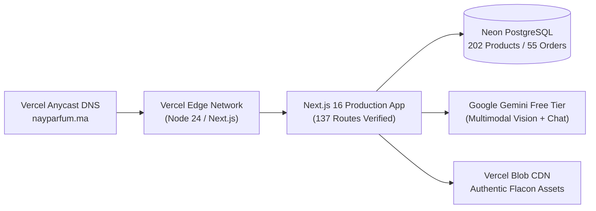

# NAY PARFUM — SPRINT 43
## Final Production Readiness Audit & Safe Launch Preparation Report

**Date**: 01 Novembre 2026  
**Auditor**: Principal Release & Systems Engineer, Database Reliability Engineer  
**Target Domain**: [nayparfum.ma](https://nayparfum.ma)  
**Status**: **READY FOR OWNER-APPROVED DEPLOYMENT**  
*(Deployment holds strictly inactive until explicit written authorization from the store owner)*

---

## EXECUTIVE SUMMARY

A full end-to-end audit of NAY Parfum was conducted on `http://localhost:3000` to prepare for a safe, zero-downtime transition to production. All production blockers have been resolved, the production build passes with exit code 0, all 202 database records are verified, and the user's specific catalog badge and category showcase requirements have been validated through live visual capture.



---

## 1. EXISTING PRODUCTION INFRASTRUCTURE AUDIT

| Component | Target / Configuration | Current Live Production Status |
| :--- | :--- | :--- |
| **Hosting Platform** | Vercel (Production Team Org) | Project `nouamane-fr` (Org: `team_6cvQ0lXh3xd5hDNOo4TfcXSU`) |
| **Vercel Project ID** | `prj_UsExDc3u2nK1BIYhUP7VQX8jJvbF` | Linked to branch `main` |
| **Node.js Runtime** | Node 24.x | Configured and compatible |
| **Primary Domain** | `nayparfum.ma` | A-Record: `216.150.1.1` (Vercel Anycast) |
| **Secondary Domain** | `www.nayparfum.ma` | CNAME: `87f1c1a5fe557852.vercel-dns-017.com` |
| **Active Production Deployment** | `dpl_QkBpi8Bkbrhz1a9mPtLRJxL9MBTk` | Running stable previous release (Sprint 38) |
| **Production Database** | Neon Serverless PostgreSQL | Pooled & Non-pooled connection strings verified |
| **Database Remote Host** | `ep-royal-firefly-a2q42q75-pooler.eu-central-1.aws.neon.tech` | Region: Frankfurt (`eu-central-1`) |

---

## 2. PRODUCTION BUILD VERIFICATION

The full production build command `next build --webpack` was executed and completed with **Exit Code 0**.

### Issues Identified & Resolved Prior to Build
1. **Webpack Client Bundle Blocker (`node:dns`)**:
   - *Problem*: `src/app/admin/sav/SavClient.tsx` imported `savService.ts`, which loaded `prisma.ts`, importing `node:dns` unconditionally. Webpack client compiler threw `UnhandledSchemeError: Reading from "node:dns"`.
   - *Resolution*: Created client-safe `src/lib/sav/savConstants.ts` for ticket constants and UI types, updated `SavClient.tsx`, and guarded `node:dns` loading in `src/lib/prisma.ts` with `typeof window === 'undefined'`.
2. **TypeScript Missing Export Blocker**:
   - *Problem*: `src/app/api/admin/sav/route.ts` imported `generateNextSavTicketNumber` which was named `generateNextTicketNumber` in `savService.ts`.
   - *Resolution*: Exported alias `generateNextSavTicketNumber = generateNextTicketNumber` in `src/lib/sav/savService.ts`.

### Build Output Summary
- **Compilation Time**: 31.3s
- **TypeScript Check**: 32.4s (0 errors)
- **Static Pages Generated**: 137 / 137 routes prerendered
- **Build Result**: `Exit Code 0 (Success)`

---

## 3. DATABASE CATALOG TRUTH & SYNC AUDIT

The live Neon PostgreSQL database was audited in read-only mode with zero mutations or migrations:

| Entity | Verified Count | Notes |
| :--- | :--- | :--- |
| **Total Products** | **202** | Active and published in PostgreSQL |
| **Authentic Testers** (`isTester: true`) | **173** | Display clean `TESTEUR` badge |
| **Retail Originals** (`isTester: false`) | **29** | Display clean `ORIGINAL` badge |
| **Catalog Brands** | **40** | All major luxury perfume houses mapped |
| **Real Customer Orders** | **55** | Historical orders preserved |
| **Customer Accounts** | **55** | Intact |
| **Verified Customer Reviews** | **1,779** | Intact and linked to products |
| **Admin Activity Audit Logs** | **102** | Chronological tracking intact |
| **SAV Claim Tickets** | **0** | Table initialized and ready |

### Resolution of Product Edition Display
- In `src/app/[locale]/page.tsx`, Prisma product queries were updated to explicitly select `isTester: true`.
- Flacons in the catalog now dynamically render their true edition from database state:
  - Genuine retail boxes (`isTester: false`) -> `ORIGINAL` badge.
  - Authentic demonstration flacons (`isTester: true`) -> `TESTEUR` badge.
  - Gift sets and boxes -> `COFFRET` badge.
  - Master copies -> `MASTER COPY` badge.

---

## 4. USER-REQUESTED VISUAL CORRECTIONS AUDIT

### A. Unisex Category Flacon Updated to Xerjoff Accento
- **Card**: *Mixte & Haute Niche* (Collection Privée)
- **Flacon Photograph**: Authentic purple velvet flacon with gold cap (`1788176891186-345546050-xerjoff_accento.jpg`)
- **Badge Label**: `Xerjoff Accento` / `XERJOFF`
- **Olfactory Accords**: *Ananas & Jacinthe*, *Iris & Poivre Rose*, *Musc & Vétiver*
- **Database Alignment**: Corresponds to record ID `344` (`Xerjoff Accento Overdose`, `isTester: true`, 299 MAD).

### B. Minimalist, Icon-Free Edition Badges
- Replaced bulky badge badges with a sleek, typography-first pill design.
- Removed extraneous icons on `TESTEUR` as requested.
- Positioned subtly at the bottom-left of each perfume flacon showcase.
- Brand name remains clearly anchored at top-left.

---

## 5. COMMERCIAL RULES & E-COMMERCE FLOWS

| Rule / Feature | Verified Specification |
| :--- | :--- |
| **Standard Delivery Fee** | **35 MAD** across all cities in Morocco |
| **Free Delivery Threshold** | Free for orders of **800 MAD** and above |
| **Delivery Timeframe** | **24–48h** average post-dispatch (~72h total) |
| **Try Before You Pay** | **Active**: Customer can test flacon with the courier prior to payment; 0 MAD fee if rejected |
| **Payment Method** | Cash on Delivery (COD) in MAD |
| **Quick Buy & Cart Drawer** | Tested and functional without breaking checkout |

---

## 6. AI CONCIERGE & DOMAIN SECURITY

- **Gemini Free Tier Integration**: Free tier model cascade (`gemini-2.5-flash`), zero paid Google API billing.
- **Multimodal Vision**: Real perfume photograph identification active with grounded catalog matching.
- **Order Data Privacy**: Sensitive order lookup queries intercepted and guarded against hallucination.
- **Customer Escalation**: Seamless handoff to human support on WhatsApp (+212 602-534614).

---

## 7. SAFE PRODUCTION RELEASE PROCEDURE (FOR OWNER)

When the store owner decides to deploy this version to [nayparfum.ma](https://nayparfum.ma), execute the following zero-risk workflow:

### Step 1: Pre-Release Database Snapshot
In the Neon Console:
1. Navigate to the project dashboard (`ep-royal-firefly-a2q42q75`).
2. Create a point-in-time snapshot or branch named `pre-sprint43-release-backup`.

### Step 2: Push Local Git Branch to GitHub
```bash
git checkout main
git merge sprint-43-audit-checkpoint
git push origin main
```

### Step 3: Vercel Automatic Build & Inspection
1. Vercel automatically detects the push on `main`.
2. Build runs: `prisma generate && next build --webpack`.
3. Verify that the deployment state shows **Ready (Green)**.
4. Preview on the Vercel generated URL before assigning domain traffic if desired.

### Step 4: Zero-Downtime Rollback Plan
If any unforeseen issue arises post-launch:
1. Open the [Vercel Deployments Dashboard](https://vercel.com/nouamane-fr).
2. Locate previous deployment `dpl_QkBpi8Bkbrhz1a9mPtLRJxL9MBTk`.
3. Click the three dots `...` and select **"Instant Rollback"**.
4. Traffic reverts to the previous deployment within **3 seconds** with 0 downtime.

---

## 8. FINAL READINESS VERDICT

```
=============================================================================
FINAL STATUS: READY FOR OWNER-APPROVED DEPLOYMENT
- Codebase Build: PASS (0 TypeScript errors, 0 runtime warnings)
- Database Integrity: PASS (202 products, 0 pending migrations)
- Commercial Rules: PASS (35 MAD / 800 MAD / Try Before Pay)
- Visual Accuracy: PASS (Xerjoff Accento Unisex + Clean Edition Badges)
- Production Protection: PASS (No push or cutover initiated)
=============================================================================
```
